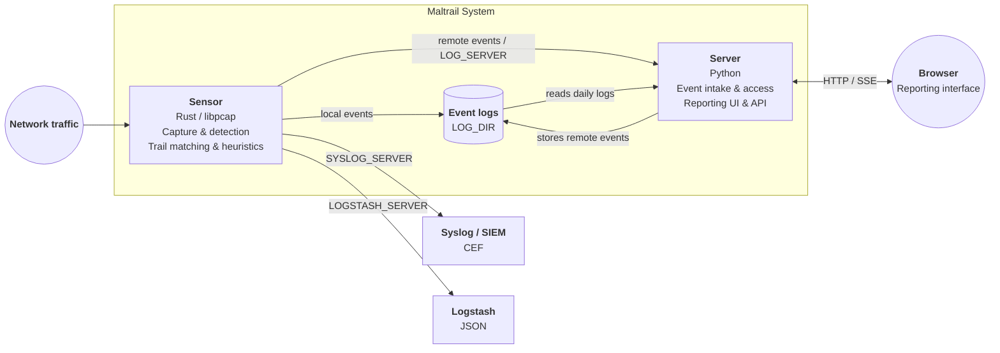

[](#license)
[](sensor/)
[](server.py)
[](#trails)
[](https://x.com/maltrail)

# Maltrail

Maltrail is a network traffic detection system that identifies communication with known malicious
infrastructure and reports selected traffic anomalies. It matches domains, URLs, IP addresses,
`IP:port` pairs, and User-Agent values observed on the network against a set of indicators called
_trails_.

A detection is recorded as a single event containing the source, destination, protocol, matched
trail, classification, and trail source:

```text
"2026-08-07 09:14:22.117034" gw 10.13.13.2 57809 1.1.1.1 53 UDP DNS malware.bakewithdavid.com "asyncrat (malware)" (static)
```

Maltrail is designed for indicator-based network monitoring. Its heuristic detections supplement
trail matching, but it is not a replacement for endpoint telemetry or a general-purpose intrusion
prevention system.

## Features

- A full trail build combining the static trail set (over 3,000 curated files, fetched from
  [stamparm/trails](https://github.com/stamparm/trails)), 39 public-feed integrations, and optional
  operator-supplied trails.
- A multithreaded Rust sensor using libpcap, with optional Linux `PACKET_FANOUT` capture workers.
- A Python server providing the reporting interface, event intake, and HTTP API.
- Plain-text custom trails and whitelists that can be reviewed and version-controlled.
- Heuristics for scanning, DNS exhaustion, DGA-like lookups, suspicious downloads, proxy probes,
  suspicious User-Agent values, and related network activity.
- Local event logging, remote Maltrail logging, CEF over syslog, and Logstash JSON output.
- Deployment validation with `maltrail-sensor -T` and optional Prometheus metrics.

## Contents

- [Architecture](#architecture)
- [Reporting interface](#reporting-interface)
- [Performance](#performance)
- [Installation](#installation)
  - [Installer](#installer)
  - [Building from source](#building-from-source)
  - [Systemd](#systemd)
  - [Docker](#docker)
- [Configuration](#configuration)
- [Trails](#trails)
- [Events and API](#events-and-api)
- [Operations](#operations)
  - [Monitoring](#monitoring)
  - [Event retention](#event-retention)
- [Documentation](#documentation)
- [Contributing](#contributing)
- [Project](#project)
  - [License](#license)
  - [Maintainers](#maintainers)
  - [Sponsors](#sponsors)
  - [Presentations and publications](#presentations-and-publications)
  - [Derived blacklist](#derived-blacklist)
  - [Third-party integrations](#third-party-integrations)
  - [Acknowledgements](#acknowledgements)

## Architecture

Maltrail has two independently deployable processes that can run on the same host or on separate
hosts: the **sensor** detects suspicious traffic, while the **server** stores and exposes events for
reporting and API access.



The sensor captures network traffic, performs trail matching and heuristic analysis, and produces
events. It can write events locally to `LOG_DIR`, send them to a remote Maltrail server through
`LOG_SERVER`, or do both. It can also emit CEF over syslog with `SYSLOG_SERVER` and JSON to
Logstash with `LOGSTASH_SERVER`.

The server accepts remote events, stores them in the event logs, reads locally available daily logs,
and provides the HTTP API and browser-based reporting interface. The sensor does not depend on the
reporting interface and can be deployed independently when events are forwarded to another system.

## Reporting interface

Maltrail includes a browser-based reporting interface for exploring detected traffic, with live
updates, field-aware search, retro hunting, geographic views, triage, sensor status, saved views and
export.


The interface is served by `server.py` at `HTTP_ADDRESS:HTTP_PORT`. It is plain JavaScript with a
single third-party runtime dependency (PapaParse, for CSV parsing) and no build step. One day is
viewed at a time, selected with a date picker that also acts as an event-density grid over the
available daily logs. Events are streamed from `/events` and aggregated in the browser into
*threats* — one row per distinct `(source, trail)` — shown in a sortable grid with a detail panel.

| Feature | Notes |
| --- | --- |
| Live mode | Appended events arrive over Server-Sent Events (`/live`) and are merged into the current view. When SSE is unavailable, or the stream cannot serve the session, the interface falls back to polling byte ranges of the daily log. New high-severity threats can raise desktop and audible alerts; both can be muted |
| Search | Field-aware queries support `src:`, `dst:`, `port:`, `proto:`, `type:`, `trail:`, `info:`, `family:`, `tag:`, `uid:`, `sev:`, `dir:` and `status:` selectors, plus exclusions, wildcards, CIDR matching and numeric comparisons. Active filters appear as removable chips |
| Retro hunt | `/hunt` searches all retained daily logs for one indicator rather than only the selected day. Searches are bounded by configurable limits; an optional per-day sidecar index accelerates the sweep and makes `/counts` exact |
| World map | `/geo` shows per-country event density for the selected day using the external endpoint of each event. Unattributable events remain unmapped rather than being guessed. `HOME_LAT` / `HOME_LON` can be set to draw origin arcs |
| Triage | Per-threat status (new / investigating / resolved / false positive), free-text notes, tags and hiding. Whitelist rules and OSINT pivots are available from the row context menu |
| Sensor status | `/sensors` shows which sensors are reporting, the version each runs and how long ago it last checked in |
| Saved views | Named filter presets |
| Export | The current filtered view as CSV, JSON, or defanged indicators |
| Appearance | Dark and light themes, with discrete text-size steps |

Search terms separated by spaces are combined as **AND**. Prefix a term with `-` to exclude it, use
`*` for wildcards, use CIDR notation such as `src:10.0.0.0/8`, and use numeric ranges or comparisons
such as `port:>1024` and `count:>=100`. `family:interlock` also includes `interlock-1` and
`interlock-2`, the shards in which that feed dump arrives.

Retro hunts are bounded by a day limit, a wall-clock budget and a sample cap. If the time budget cuts
a day short, that day is reported separately rather than counted as a completed day. Only lines
that can contain the indicator are parsed, so a day of non-matching lines is read at disk speed.

Sensor liveness is tracked separately from event activity: a failed sensor and a healthy sensor on a
quiet link can both produce no events. Sensors therefore announce themselves over the `LOG_SERVER`
channel every `HEARTBEAT_PERIOD` seconds. When `LOG_SERVER_SECRET` is configured, heartbeats are
signed in the same way as events.

Triage state, saved views, tags and appearance settings are stored in the **browser**
(`localStorage`), not on the server. They are therefore per-browser and per-origin and are not shared
between analysts.

Sessions restricted with a network filter see only events from their own networks. The same
restriction also applies to the counts, map and blacklist endpoints, not only to the event list.

Country and ASN enrichment for individual addresses is looked up at `stat.ripe.net` by the
**server**, cached there, and exposed to the interface through Maltrail's own `/ripe` endpoint. The
browser talks to nothing but Maltrail. Set `DISABLE_RIPE_LOOKUPS` to disable outbound lookups
entirely. Without RIPE lookups — including on hosts without internet access — flags fall back to the
local RIR table and the rest of the interface continues to work offline.

## Performance

Performance depends on processor, traffic composition, trail-set size, capture driver, and network
interface. The figures below are offline replays through the release binary: libpcap read, link
layer, packet path and event writing, one worker pinned to one core. Trail loading is excluded, and
they are not live-capture measurements.

Measured on an AMD Ryzen 7 PRO 4750U with the shipped `maltrail.conf` (heuristics on, condensed
store on) and refnet's 1.6 million-row trail set, 1,000,000 packets per row:

| Traffic | Time per packet |
| --- | ---: |
| ICMP echo, 94 bytes | 112 ns |
| TCP SYN, 54 bytes | 181 ns |
| Bulk TLS, 1,473 bytes | 351 ns |
| DNS query with a warm cache, 71 bytes | 287 ns |
| Refnet mix, 85-byte average | 354 ns |
| TLS ClientHello, 126 bytes | 590 ns |
| DNS query with a unique name, 72 bytes | 623 ns |
| HTTP request, 159 bytes | 678 ns |

Every row is cut out of refnet, the synthetic reference network the detection figures come from
(`sensor/tools/refnet.py`); the tool says how each row was built. Figures in this README before
October 2026 were read off a timer quantized to 50 ms and are not comparable.

Detection itself is asserted separately: every case of the replay corpus in
`sensor/tests/corpus/` declares the events it must produce, and `sensor/tests/replay.rs` checks
them on every test run.

Measure it on the target system with:

```bash
cargo build --release --manifest-path sensor/Cargo.toml
python3 sensor/tools/perf_table.py
```

One capture worker is used by default. Additional workers increase capture capacity, and with more
than one the sensor distributes packets by source address (`CAPTURE_FANOUT_MODE source`), so each
scanner stays on one worker and the scan heuristics keep all their alerts. Plain flow hashing
(`hash`) would split a scanner across workers: in the documented test it kept 91% of single-worker
heuristic alerts at two workers, 87% at four and 66% at eight. Exact trail matching is unaffected
either way. Add workers when capture-drop metrics show that one is not keeping up.

The packet-path benchmarks are `cargo bench --bench hotpath` (see [`sensor/README.md`](sensor/README.md)),
and live `PACKET_FANOUT` distribution is checked with `sensor/tools/fanout_check.py`.

## Installation

### Installer

The installer is verified on twelve Linux distributions, counting releases (Debian 12 and 13,
Ubuntu 22.04 and 24.04, Fedora 41 and 44, Rocky, AlmaLinux, Arch, openSUSE Leap and Tumbleweed,
and Alpine), plus FreeBSD, NetBSD, OpenBSD and macOS. The matrix is re-run weekly and whenever the installer changes,
with the full result recorded in [`docs/compat`](docs/compat). Raspberry Pi OS and other
64-bit ARM systems use the `aarch64` build. On 32-bit ARM, the Pi 2 and later use a static ARMv7
build with NEON (`armv7-unknown-linux-musleabihf`), and the Pi 1, the Zero and any ARMv7 CPU
without NEON, VFPv4 and hardware divide use a static ARMv6 build (`arm-unknown-linux-musleabihf`).
The installer picks the right one, and the sensor fits in a 256 MB Pi.

```bash
curl -fsSL https://raw.githubusercontent.com/stamparm/maltrail/master/install.sh | sudo sh
```

It installs dependencies, creates a managed checkout of the latest release under `/opt/maltrail`, verifies the checksum
of the prebuilt sensor, creates an unprivileged `maltrail` account, installs systemd units, prepares
the log and state directories, and starts the sensor and server. Re-running the installer upgrades
the managed checkout.

Review the script before running it with elevated privileges. From an existing checkout, the dry
run shows the commands without changing the system:

```bash
sh install.sh --dry-run
```

Common installer options:

```bash
sh install.sh --role sensor      # Install only the sensor
sh install.sh --ref master       # Track master instead of the latest release
sh install.sh --no-service       # Install without changing systemd
sh install.sh --dry-run          # Print commands without applying them
sh install.sh --uninstall        # Remove the managed installation; keep logs and state
```

The dashboard is available at <http://127.0.0.1:8338> after installation; the installer prints
the `admin` password it generated, once. Note that the shipped `HTTP_ADDRESS` is `0.0.0.0`, so the
dashboard is reachable on **every** interface. The `admin` / `changeme!` login in the shipped
`maltrail.conf` (a manual or Docker setup) is accepted only from the server itself; set your own
in `USERS` to sign in over the network, and put the server behind TLS (`USE_SSL`, or a reverse
proxy) before the host is on an untrusted network.

The initial trail build can take several minutes. The sensor does not detect trail matches until a
valid trail set is available. The systemd unit runs the sensor's `-T` validation before startup so
that missing privileges, an unwritable log directory, or an invalid trail set causes startup to
fail visibly.

The installer test harness covers twelve distributions, and "it installed" is not the assertion: in
each one the server is started and asked for `/ping`, the sensor is asked to validate itself with
`-T`, the units are checked for paths that resolve, the installer is re-run to prove an upgrade
keeps operator configuration, and `--uninstall` is run. Every result is recorded per platform in
[`docs/compat`](docs/compat), and the page there is generated from those rows rather than written
by hand.

Alpine and other musl systems get a `-musl` sensor build. They used to be told the prebuilt binary
was glibc-linked and to compile their own; the sensor builds and runs on musl natively, so that was
a missing artifact rather than a platform limit.

### Building from source

The sensor requires Rust 1.74 or newer, libpcap development headers, and the system's capability
tools. The server and trail updater require Python 3.6 or newer.

Install the distribution packages:

```bash
# Debian / Ubuntu / Raspberry Pi OS
sudo apt-get install cargo libpcap-dev libcap2-bin python3

# RHEL / Fedora
sudo dnf install cargo libpcap-devel libcap python3

# openSUSE / SLES
sudo zypper install cargo rust libpcap-devel libcap-progs python311
```

Then build and validate the sensor:

```bash
git clone --depth 1 https://github.com/stamparm/maltrail.git
cd maltrail

cargo build --release --manifest-path sensor/Cargo.toml

sudo setcap cap_net_raw,cap_net_admin=eip \
  sensor/target/release/maltrail-sensor

sudo install -d -o "$USER" -g "$(id -gn)" -m 750 /var/log/maltrail

sensor/target/release/maltrail-sensor -T
sensor/target/release/maltrail-sensor
```

Start the server in another terminal or on another host:

```bash
python3 server.py
```

Prebuilt sensor binaries are attached to current releases with SHA-256 checksums: Linux `x86_64`
and `aarch64` against both glibc and musl, 32-bit ARM (`armv6`/`armv7`, static musl), macOS on Apple
silicon and Intel, FreeBSD `amd64`, and Windows `x86_64`.

A binary is not a complete sensor on its own. Install with `install.sh` (or `install.ps1` on
Windows), which downloads the right binary for you.

The glibc builds link libpcap statically and target glibc 2.28, so the C library is the only thing
they need — nothing to install, on RHEL 8+, Debian 10+, Ubuntu 20.04+ and Leap 15.6 alike. The musl
builds are fully static, so Alpine needs nothing at all. The Windows build is 64-bit and needs Windows 10 or later plus
[Npcap](https://npcap.com) installed before it will start — `wpcap.dll` is a load-time dependency,
so without it the loader refuses the executable rather than failing at capture. The archive says so
too. From a checkout, `install.ps1` does the rest:

```powershell
powershell -ExecutionPolicy Bypass -File install.ps1
```

It refuses to install without Npcap, puts the binary, configuration and support tree under
`%ProgramFiles%\Maltrail`, keeps logs and the trail set in `%ProgramData%\Maltrail`, seeds the trail
set from the release, runs the sensor's own `-T` preflight, and starts it at boot as SYSTEM via a
scheduled task. `-Uninstall` removes the task and the program directory and keeps everything under
`%ProgramData%`.

Binaries from **3.1.1 and earlier** did not: they linked libpcap dynamically, and asked for it by
the name their AlmaLinux build host uses. Debian and Ubuntu ship the identical library under the
older name `libpcap.so.0.8`, so those binaries stop before they start —

```
./maltrail-sensor: error while loading shared libraries: libpcap.so.1: cannot open shared object file
```

— on a machine that has libpcap installed. `install.sh` links the missing name for you. By hand:

```bash
# adjust the directory for your architecture: aarch64-linux-gnu, or /usr/lib64 on RPM distributions
sudo ln -sf /usr/lib/x86_64-linux-gnu/libpcap.so.0.8 /usr/lib/x86_64-linux-gnu/libpcap.so.1
sudo ldconfig
```

### Systemd

The supplied `packaging/systemd/` units run both processes as the
unprivileged `maltrail` user. Systemd creates `/var/log/maltrail` and `/var/lib/maltrail`, restricts
filesystem access, and grants the sensor `CAP_NET_RAW` and `CAP_NET_ADMIN`.

The installer configures these units automatically. For an existing source installation, follow
the manual service procedure in [`sensor/docs/INSTALL.md`](sensor/docs/INSTALL.md).

Check service state and logs with:

```bash
systemctl status maltrail-sensor maltrail-server
journalctl -u maltrail-sensor -f
```

### Docker

Start the supplied Compose deployment with:

```bash
docker compose -f docker/docker-compose.yml up -d
```

Container configuration, storage, privileges, and health checks are documented in
[`docker/README.md`](docker/README.md).

## Configuration

Maltrail reads `maltrail.conf`, which contains separate `[Sensor]` and `[Server]` settings. The
installer places the managed configuration at `/etc/maltrail.conf`.

Frequently used sensor options include:

| Option | Purpose |
| --- | --- |
| `MONITOR_INTERFACE` | Capture interface or interfaces; `any` selects all supported interfaces |
| `CAPTURE_FILTER` | BPF capture filter |
| `CAPTURE_WORKERS` | Capture workers, one socket each; defaults to one |
| `LOG_DIR` | Local event-log directory |
| `TRAILS_FILE` | Generated trail database |
| `LOG_SERVER` | Remote Maltrail event server |
| `SYSLOG_SERVER` | CEF syslog destination or destinations |
| `LOGSTASH_SERVER` | Logstash JSON destination or destinations |
| `STATS_ADDRESS` | Prometheus metrics listener; disabled unless configured |
| `UPDATE_PERIOD` | Trail refresh interval |
| `STATIC_TRAILS_URL` | Where the assembled static trail set is fetched from; pin it to a dated release to control when new content lands |
| `USER_WHITELIST` | Operator-managed indicators that should not alert |
| `CUSTOM_TRAILS_DIR` | Operator-managed trail directory |
| `STATIC_TRAILS_DIR` | Optional checkout of the trails repository; only used to show a trail's source citation in the UI |

Run the deployment check after changing configuration:

```bash
sensor/target/release/maltrail-sensor -T
```

The check validates configuration, trails, whitelist entries, capture filter, privileges, log
storage, update support, and worker settings. A successful check includes positive trail and
whitelist counts rather than only confirming that files exist.

## Trails

A trail is one indicator — a domain, URL, IP address, `IP:port` pair, User-Agent, JA3/JA4
fingerprint or certificate hash — together with what it means and where it came from. The updater
merges five sources into `TRAILS_FILE`, in this order:

| source | where it comes from |
| --- | --- |
| Feeds | `feeds/*.py`, fetched directly by your deployment from each publisher, e.g. [IPnoise](https://ipnoise.sekuripy.hr/) |
| Custom | `CUSTOM_TRAILS_DIR`, your own indicators |
| Static | the assembled set from [stamparm/trails](https://github.com/stamparm/trails), fetched from `STATIC_TRAILS_URL`; [separately licensed](https://github.com/stamparm/trails/blob/main/LICENSE.md) |
| Engine lists | `data/mass_scanner.txt`, shipped here because it changes rarely |
| Remote custom | `CUSTOM_TRAILS_URL`, merged last; it does not override custom or static entries |

Feeds are fetched by your own deployment rather than bundled here, so each is as current as its
publisher keeps it. [IPnoise](https://ipnoise.sekuripy.hr/), for example, publishes the addresses
caught attacking a distributed network of honeypot sensors — hosts running no legitimate service,
so every connection reaching them is hostile by construction — and `feeds/ipnoise.py` pulls its
7-day list.

The static trails live in their own repository. Detection content changes tens of times a
day; the engine does not, and keeping them together meant updating detection required pulling code
and made this repository's history unusable. `STATIC_TRAILS_URL` points at the newest published
set:

```text
STATIC_TRAILS_URL https://github.com/stamparm/trails/releases/latest/download/trails.csv.gz
```

Point it at a specific `content-YYYYMMDD-HHMM` release instead to pin a version, so a bad publish
is not immediately global. The set is cached next to `TRAILS_FILE`, which is what makes an offline
or air-gapped rebuild work; the published `sha256` is checked before downloading, so a deployment
that updates more often than the content changes transfers 65 bytes rather than 11 MB, and a
payload that does not match its digest is refused in favor of the cache.

`update_trails()` publishes a new `TRAILS_FILE` atomically and only after a successful build. Feeds
that return nothing are reported by name, so a deployment does not silently depend on a source that
has quietly retired.

Add your own indicators under `CUSTOM_TRAILS_DIR`, and anything that must never raise an event to
`USER_WHITELIST`. Keep both outside the installation directory so an upgrade cannot overwrite them.

Static trail contributions go to [stamparm/trails](https://github.com/stamparm/trails); new feeds
go here. Either way an indicator needs a classification and a source somebody can check — see
[Contributing](#contributing).

## Events and API

Maltrail records one whitespace-separated event per detection, using CSV quoting where a value
contains spaces:

```text
"<time>" <sensor> <src_ip> <src_port> <dst_ip> <dst_port> <proto> <type> <trail> "<info>" <reference>
```

The `type` field identifies what matched, including `DNS`, `IP`, `IPORT`, `URL`, `PATH`, `HTTP`,
`UA`, `PORT`, `CERT`, `JA3`, and `JA4`. The `info` field contains the trail classification, and
`reference` identifies the static list, feed, custom source, or heuristic that produced it. The
`JA3`/`JA4` types fire on TLS *client* fingerprints: an implant's TLS stack survives every
address and domain rotation, so its hello hash keeps matching after everything else has burned
(published by the abuse.ch SSLBL JA3 feed).

### Indicator lookup

Use `/check` to query one domain, IP address, or URL:

```bash
curl 'http://127.0.0.1:8338/check?q=www.sub.evil.example'
```

```json
{
  "query": "www.sub.evil.example",
  "found": true,
  "trail": "evil.example",
  "info": "asyncrat (malware)",
  "reference": "(static)",
  "confidence": 100
}
```

The `confidence` field (0-100, or `null` when unavailable) says how strongly the sources back the
listing: 40 for a single feed, +15 per additional feed agreeing independently up to 100, and full
marks for the operator's own custom and static entries. It is computed at trail-update time from
feed agreement into a `trails.confidence` sidecar next to `trails.csv`; a server pulling trails
from an `UPDATE_SERVER` has no provenance to score and reports `null`. Use it to prioritize
triage - a single-feed listing at 40 deserves a second look before it earns a firewall rule.

A subdomain lookup can match its listed parent. URL lookups check `host/path` before checking the
host alone. The server reads the memory-mapped trail database and observes trail updates without a
restart.

Public static and feed trails are available without authentication, consistent with the `/trails`
endpoint used by remote sensors. Custom trails require an authorized session; an unauthorized
custom-only lookup is reported as a miss. Event data remains authenticated.

## Operations

### Monitoring

Use `maltrail-sensor -T` as a deployment and configuration gate. The supplied systemd unit runs it
as `ExecStartPre`.

To confirm that detection itself works — not just that the processes start — run:

```bash
python3 server.py --detect-test
```

It replays a crafted pcap of emulated malicious traffic (trail hits on a DNS query, an IP, an
`IP:port`, a URL path and a `Host` header, plus the SQL-injection, traversal, RCE, XSS, proxy-probe,
sinkhole, missing-`Host` and port/web/infection-scanning heuristics) through the installed sensor
and asserts that every expected detection fires. It needs no root, no interface and no trail set of
its own. A healthy install prints `27/27 detection(s) fired`.

When `STATS_ADDRESS` is configured, monitor at least these Prometheus metrics:

| Metric | Operational meaning |
| --- | --- |
| `maltrail_up == 0` | No capture worker is running |
| Increasing `maltrail_capture_dropped_total` | The capture ring is dropping packets |
| Increasing `maltrail_local_log_errors_total` | Events were produced but could not be written locally |
| Increasing `maltrail_remote_log_errors_total` | Events could not be delivered to a remote sink; with `DISABLE_LOCAL_LOG_STORAGE` they are lost |
| `maltrail_trail_generation` not advancing | The active trail set is not being refreshed |
| `maltrail_log_dir_free_bytes` | Remaining capacity for local event storage |
| Increasing `maltrail_state_saturations_total` | A heuristic state limit was reached |
| Increasing `maltrail_throttle_evictions_total` | The event-throttle table is at its cap, so events are aggregated earlier than configured |

State saturation affects the corresponding heuristic; exact trail matching remains active.

Send `SIGHUP` or use `systemctl reload maltrail-sensor` to request a trail reload. Trail files
updated by another process are detected automatically and published to workers without restarting
the sensor.

The condensed observable store (`USE_CONDENSED_STORAGE`, `meta.sqlite`) supports the server's
novelty and retro-hunt views. What the sensor reads and writes, every detection, and its design
decisions and limitations are documented in [`sensor/docs/BEHAVIOUR.md`](sensor/docs/BEHAVIOUR.md).

### Event retention

Maltrail does not rotate or delete event logs. Operators are responsible for defining retention,
archival, and deletion according to storage requirements and organizational policy.

Recommended practices:

- Send the durable event copy to a remote Maltrail server or SIEM with `LOG_SERVER`,
  `SYSLOG_SERVER`, or `LOGSTASH_SERVER`.
- Alert on `maltrail_log_dir_free_bytes` with enough headroom for the expected event rate.
- Rotate, archive, or remove local daily logs using external tooling.
- Keep files needed by the reporting interface uncompressed in `LOG_DIR`; archive compressed files
  elsewhere.

When the log filesystem is full, the sensor cannot append events. Event logs may also contain IP
addresses and domains that are regulated as personal data in some jurisdictions; retention policy
should account for the applicable requirements.

### Synthetic traffic

To check that detection and the dashboard both still work, without waiting for real traffic:

```bash
python3 server.py --detect-test                      # assert every detection fires, then exit
python3 server.py --detect-test --keep DIR --serve   # ...and keep the events, serving them on :8338
```

`--keep` also replays `sensor/tests/corpus/` into the same log and prints which of the shapes the
dashboard renders differently have an event behind them, so a missing icon, color or glyph is
visible rather than assumed. Timestamps are shifted so the newest day is today. A sensor binary is
required (`cargo build --release --manifest-path sensor/Cargo.toml`).

The public demo's data is regenerated from such a run:

```bash
python3 sensor/tools/gen_demo_js.py --from DIR/logs   # tops up html/js/demo.js
```

## Documentation

| Document | Contents |
| --- | --- |
| [`sensor/docs/INSTALL.md`](sensor/docs/INSTALL.md) | Installation, privileges, configuration, and troubleshooting |
| [`sensor/docs/ARCHITECTURE.md`](sensor/docs/ARCHITECTURE.md) | Sensor internals and data flow |
| [`sensor/docs/BEHAVIOUR.md`](sensor/docs/BEHAVIOUR.md) | Inputs and outputs, detections, design decisions, limitations |
| [`SekuriPy Labs`](https://www.sekuripy.hr/labs/maltrail/) | Engineering notes, benchmarks and write-ups |

## Contributing

Trail additions, feed maintenance, bug reports, documentation, and sensor improvements are welcome.
Trail submissions should include a reliable source and should use the narrowest appropriate
classification.

Run the relevant checks before submitting code. The complete sensor gate is:

```bash
bash sensor/tools/check.sh
```

It runs formatting, Clippy with warnings denied, and the debug and release test suites. Run the
Python server suite with:

```bash
bash tests/run.sh python3
```

The Windows build can be exercised from Linux, which is where its bugs have been found:

```bash
sh sensor/tools/check_windows.sh
```

It cross-compiles the sensor with mingw-w64, extracts Npcap's userspace library from its installer
(an NSIS archive, so nothing is installed), and runs the result under Wine — the whole unit suite,
`-T` against the shipped configuration, the pcap corpus compared byte for byte against the native
binary, and the server answering `/ping` under a Windows Python. Live capture is the one thing it
cannot cover; that needs Npcap's kernel driver and a real Windows machine. Prerequisites are
`gcc-mingw-w64-x86-64`, `wine`, and `p7zip-full`.

## Project

### License

**TL;DR:** Maltrail is MIT-licensed, but the Maltrail Trails dataset has separate terms. Independent IOC lookup/reference is fine; systematic use of Trails as an intelligence source in a commercial product or service requires permission/licensing.

Maltrail is distributed under the MIT License. See [`LICENSE`](LICENSE).

That is the engine. The static trail set is separate work under separate terms: free for internal
defensive use, research and teaching, but a commercial product, service, MSSP or MDR offering, or a
redistributed feed needs a license. An MIT engine does not make the content free to sell — see
[`LICENSE.md`](https://github.com/stamparm/trails/blob/main/LICENSE.md) in
[stamparm/trails](https://github.com/stamparm/trails) before shipping it in something you charge
for.

### Maintainers

- Miroslav Stampar ([@stamparm](https://github.com/stamparm))
- Mikhail Kasimov ([@MikhailKasimov](https://github.com/MikhailKasimov))

### Sponsors

- [Sansec](https://sansec.io/) (2024–2025)
- [Sansec](https://sansec.io/) (2020–2021)

### Presentations and publications

- 47th TF-CSIRT Meeting, Prague, 2016
  ([slides](https://web.archive.org/web/20161109135211/https://www.terena.org/activities/tf-csirt/meeting47/M.Stampar-Maltrail.pdf))
- _Detect attacks on your network with Maltrail_, Linux Magazine, 2022
  ([article](https://www.linux-magazine.com/Issues/2022/258/Maltrail))
- _Best Cyber Threat Intelligence Feeds_, Silent Push, 2022
  ([review](https://www.silentpush.com/blog/best-cyber-threat-intelligence-feeds))
- _Research on Network Malicious Traffic Detection System Based on Maltrail_, Nanotechnology
  Perceptions, 2024
  ([paper](https://nano-ntp.com/index.php/nano/article/view/1915/1497))

### Third-party integrations

- [FreeBSD Port](https://www.freshports.org/security/maltrail)
- [OPNsense Gateway Plugin](https://github.com/opnsense/plugins/pull/1257)
- [D4 Project](https://www.d4-project.org/2019/09/25/maltrail-integration.html)
- [BlackArch Linux](https://github.com/BlackArch/blackarch/blob/master/packages/maltrail/PKGBUILD)
- [Validin](https://x.com/ValidinLLC/status/1719666086390517762)
- [Maltrail Add-on for Splunk](https://splunkbase.splunk.com/app/7211)
- [Maltrail decoder and rules for Wazuh](integrations/wazuh/)
- [GScan](https://github.com/grayddq/GScan) (trails only)
- [MalwareWorld](https://www.malwareworld.com/) (trails only)
- [oisd domain blocklist](https://oisd.nl/?p=inc) (trails only)
- [NextDNS](https://github.com/nextdns/metadata/blob/e0c9c7e908f5d10823b517ad230df214a7251b13/security/threat-intelligence-feeds.json) (trails only)
- [NoTracking](https://github.com/notracking/hosts-blocklists/blob/master/SOURCES.md) (trails only)
- [OWASP Mobile Audit](https://github.com/mpast/mobileAudit/pull/182/changes/1e9faad9a3dfd8ce9b656e05bfc955a7d6f20bef) (trails only)
- [Mobile Security Framework MobSF](https://github.com/MobSF/Mobile-Security-Framework-MobSF/commit/822123826b4bc800554f0f7b4be49967db506b03) (trails only)
- [pfBlockerNG-devel](https://github.com/pfBlockerNG/pfBlockerNG/commit/6765a139c6470cbeaf89cb5d2c03c8598544b31f) (trails only)
- [Sansec eComscan](https://sansec.io/kb/about-ecomscan/ecomscan-license) (trails only)
- [Palo Alto Networks Cortex XSOAR](https://xsoar.pan.dev/docs/reference/integrations/github-maltrail-feed) (trail connector)

### Acknowledgements

- Thomas Kristner
- Eduardo Arcusa Les
- James Lay
- Ladislav Baco (@laciKE)
- John Kristoff (@jtkdpu)
- Michael M&uuml;nz (@mimugmail)
- David Brush
- @Godwottery
- Chris Wild (@briskets)
- Keith Irwin (@ki9us)
- Simon Szustkowski (@simonszu)
